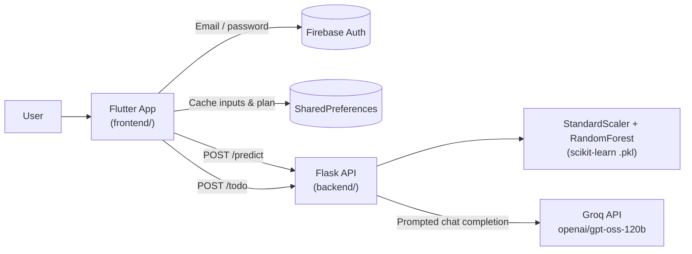

# 🌸 PCOS Wellness Assistant

A full-stack wellness companion for people managing **PCOS (Polycystic Ovary Syndrome)**. It pairs a **machine-learning severity classifier** with an **LLM-generated, personalized lifestyle plan**, delivered through a calm, cross-platform **Flutter** app.

> ⚠️ **Disclaimer:** This is an educational project and not a medical device. Predictions and plans are not a diagnosis and do not replace professional medical advice.

---

## 📌 Table of Contents

- [Highlights](#-highlights)
- [Architecture](#-architecture)
- [Tech Stack](#-tech-stack)
- [Project Structure](#-project-structure)
- [Quick Start](#-quick-start)
- [API Reference](#-api-reference)
- [How the ML Model Works](#-how-the-ml-model-works)
- [Design Decisions](#-design-decisions)
- [Roadmap](#-roadmap)

---

## ✨ Highlights

| Feature | What it does |
|---|---|
| 🔐 **Authentication** | Email/password sign-up and sign-in using Firebase Auth |
| 🧬 **Severity assessment** | A guided multi-step form collects vitals, symptoms, cycle data and hormone values. A Random Forest model classifies severity as **Mild / Moderate / Severe** |
| 📝 **AI wellness plan** | OpenAI's open-weight `gpt-oss-120b` LLM, served by Groq, generates a structured, non-clinical plan covering daily routine, weekly habits, diet, exercise, general supplements, lifestyle changes, things to avoid, progress tracking and a motivational note |
| 💾 **Local persistence** | Assessment inputs and the generated plan are cached with `shared_preferences`, so returning users see their plan instantly. A refresh action regenerates it |
| 🎨 **Supportive UI** | Material 3, Poppins typography, soft gradients and rendered Markdown for the plan |

---

## 🏗 Architecture



**Request flow**
1. The user signs in through Firebase Auth.
2. The symptoms form saves the inputs locally and posts them to `/predict`. The backend scales the features, runs the classifier and returns a severity label, which the app shows in a result dialog.
3. On the plan screen, the app sends the saved profile to `/todo`. The backend builds a prompt with safety rules (no diagnosis, no dosages, no citations) and returns the LLM's Markdown plan.
4. The app caches the plan locally and renders it as Markdown.

---

## 🧰 Tech Stack

| Layer | Technology |
|---|---|
| **Frontend** | Flutter (Dart SDK ^3.9), Material 3, `google_fonts`, `flutter_markdown`, `smooth_page_indicator` |
| **Auth** | Firebase Core + Firebase Auth |
| **Networking / Storage** | `http` (singleton client), `shared_preferences` |
| **Backend** | Python, Flask, Flask-CORS |
| **ML** | scikit-learn (`RandomForestClassifier`, `StandardScaler`), NumPy, joblib |
| **Generative AI** | Groq Chat Completions API (`openai/gpt-oss-120b`) |

---

## 📁 Project Structure

```
.
├── backend/                     # Flask REST API
│   ├── app.py                   # Routes: /predict, /todo
│   ├── requirements.txt
│   ├── model/
│   │   ├── pcos_severity_model.pkl   # Trained RandomForest classifier
│   │   └── scaler.pkl                # Fitted StandardScaler
│   └── services/
│       ├── predict_service.py   # Feature engineering + inference
│       └── todo_service.py      # Prompt building + Groq API call
│
├── frontend/                    # Flutter app (Android, iOS, Web, Desktop)
│   ├── lib/
│   │   ├── main.dart            # App entry, theme, routes
│   │   ├── firebase_options.dart
│   │   ├── core/
│   │   │   ├── network/         # ApiEndpoints, HttpClient
│   │   │   └── storage/         # SharedPrefs wrapper
│   │   └── feature/             # Feature-first modules
│   │       ├── Auth/            # Sign in / sign up
│   │       ├── Symptoms/        # Multi-step assessment (page, model, repository)
│   │       ├── Home/            # Dashboard & entry to the assessment
│   │       └── Todo/            # AI wellness plan (page, repository)
│   └── pubspec.yaml
│
└── run.bat                      # One-click launcher for backend + frontend (Windows)
```

---

## 🚀 Quick Start

### Prerequisites

- **Python 3.10+** and `pip`
- **Flutter SDK** (Dart ^3.9.2). Check your setup with `flutter doctor`
- A free **Groq API key**, needed only for the wellness plan endpoint ([get one here](https://console.groq.com/keys))

### 1. Clone

```bash
git clone <your-repo-url>
cd <repo-folder>
```

### 2. Set up the backend

```bash
cd backend
python -m venv .venv
# Windows
.venv\Scripts\activate
# macOS / Linux
source .venv/bin/activate

pip install -r requirements.txt
```

Set your Groq API key:

```bash
# Windows (cmd)
set API_KEY=your_key_here
# Windows (PowerShell)
$env:API_KEY="your_key_here"
# macOS / Linux
export API_KEY=your_key_here
```

Run the server. It listens on `http://0.0.0.0:8000`:

```bash
python app.py
```

### 3. Set up the frontend

Point the app at your backend in `frontend/lib/core/network/api_endpoints.dart`:

```dart
static const String baseUrl = 'http://localhost:8000';      // Web / desktop on the same machine
// static const String baseUrl = 'http://10.0.2.2:8000';    // Android emulator
// static const String baseUrl = 'http://<your-LAN-IP>:8000'; // Physical device on the same Wi-Fi
```

Then install the dependencies and run:

```bash
cd frontend
flutter pub get
flutter run -d chrome        # or: -d web-server, -d windows, or a connected device
```

> 🔥 **Firebase:** The repo ships with a configured `firebase_options.dart`. To use your own Firebase project, run `flutterfire configure` inside `frontend/` and enable **Email/Password** sign-in in the Firebase console.

### ⚡ One-click run (Windows)

After completing the setup steps once, run this from the repo root:

```bat
run.bat
```

It opens two terminals: **BACKEND** runs the Flask API and **FRONTEND** runs `flutter run -d web-server`. It also warns you if `API_KEY` isn't set.

---

## 📡 API Reference

Base URL: `http://localhost:8000`

### `POST /predict`: classify PCOS severity

**Request**
```json
{
  "age": 25, "bmi": 27.1, "weight": 68,
  "weight_gain": "yes", "hair_growth": "no", "skin": "yes",
  "hair_loss": "no", "acne": "yes", "irregular_cycle": "yes",
  "cycle_length_days": 40,
  "fsh": 5.0, "lh": 12.0, "amh": 6.0, "tsh": 2.0, "prl": 15.0
}
```
Symptom flags accept `yes / y / true / 1`; anything else counts as "no". Hormone values are optional and default to `0`.

**Response** `200`
```json
{ "pcos_severity": "Moderate" }
```

### `POST /todo`: generate a personalized wellness plan

**Request:** the same user profile as `/predict`. The app sends the assessment data it saved locally.

**Response** `200`
```json
{ "todo": "### 🌅 Daily Routine\n- ...\n### 🍽️ Diet Plan\n- ..." }
```

Errors are returned as `{ "error": "<message>" }`, with status `400` for empty input and `500` for server or LLM failures.

---

## 🧠 How the ML Model Works

- **Model:** `RandomForestClassifier` that outputs one of `Mild`, `Moderate` or `Severe`
- **Preprocessing:** `StandardScaler` fitted on the training data, saved alongside the model with `joblib`
- **16 input features:**
  - *Vitals:* age, BMI, weight
  - *Symptoms (binary):* weight gain, excess hair growth, skin darkening, hair loss, acne, irregular cycle
  - *Cycle:* cycle length in days
  - *Hormones:* FSH, LH, AMH, TSH, PRL
  - *Engineered:* **LH/FSH ratio**, a known clinical marker for PCOS, with a guard against division by zero
- **Serving:** The model and scaler load once at startup. Each request becomes a single feature vector that is scaled and then classified.

---

## 🧩 Design Decisions

- **Feature-first Flutter structure.** Each feature (`Auth`, `Symptoms`, `Home`, `Todo`) owns its page, model and repository, while shared concerns live in `core/`. Features stay isolated and easy to extend.
- **Repository pattern.** UI widgets never call HTTP directly. Repositories wrap a singleton `HttpClient` with centralized error handling.
- **Thin routes, service layer.** Flask routes handle only validation and response shaping. The ML and LLM logic live in `services/`, so each can be tested and swapped independently.
- **Guard-railed prompting.** The LLM prompt explicitly forbids diagnoses, dosages, citations and URLs, and enforces a fixed section layout. This keeps output safe, consistent and easy to render.
- **Offline-friendly UX.** Caching the plan locally removes repeated (and paid) LLM calls and gives users instant access to it.

---


## 💗 Vision

To build an accessible digital companion for people managing PCOS that offers clarity, comfort and guidance without medical overwhelm.
